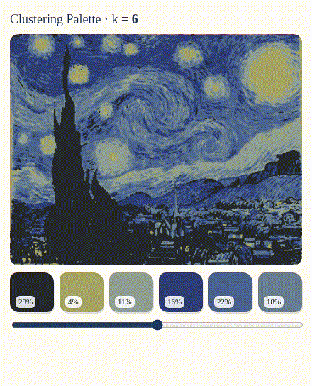

# Clustering Palette: K-means + Gaussian Mixtures (EM)

A small in-browser tool that shows how a computer decides which colors "belong together".
Pick a painting or film still (or upload your own image). The tool groups its pixels into *k* colors with **K-means**, then fits a **Gaussian mixture model with EM** so you can see where the machine is *unsure*.

I made it so kids can see how an AI "decides" colors, and that its answer isn't the only one.



## Run it

It's plain HTML/CSS/JS with no build step and no dependencies. The page loads `credits.json` with `fetch`, so serve it over HTTP rather than opening the file directly:

```bash
cd KNN-clustering-palette
python3 -m http.server 8000
# then open http://localhost:8000/
```

Uploaded images are processed only in your browser. Nothing is sent anywhere.

## How it works

1. **Color space.** Each pixel is converted from sRGB to **CIE Lab**. Straight-line distance in Lab roughly matches how different two colors *look*, so the clusters are less muddy than in raw RGB (see `process/step2-3-rgb-vs-lab.png`).
2. **Sampling.** To keep the *k* slider responsive, the model is fitted on **6,000 randomly sampled pixels**. Every pixel is then assigned using the fitted model.
3. **K-means (hard clustering).** k-means++ initialisation, then 25 Lloyd iterations. Each pixel belongs to exactly one cluster. The palette shows each cluster's mean RGB color and its share of the picture.
4. **Gaussian mixture via EM (soft clustering).** Starting from the K-means result, 30 EM iterations fit a mixture of *k* Gaussians with **diagonal covariances**. Each pixel gets a probability for every cluster ("70% blue, 30% purple").
5. **Uncertainty map.** For each pixel, the entropy of its membership probabilities is shown as brightness. Brighter means the model is less sure, usually on edges and blended brushwork.
6. **Tap a pixel** on the original image to see its soft memberships as bars.

### Limitations

- Diagonal covariances can't capture tilted or elongated color clusters.
- Random sampling means results can vary slightly between runs.
- Everything runs on a ~560 px preview, so borders are coarse.
- A human still chooses *k*.

## Files

| Path | What it is |
|---|---|
| `index.html` | The page, with all JavaScript inline (Lab conversion, K-means, EM/GMM, rendering) |
| `style.css` | Styles |
| `credits.json` | Sample image list and credits (read by the page) |
| `samples/` | Sample images (public domain, resized to ≤1000 px) |
| `process/step2-3-rgb-vs-lab.png` | RGB vs Lab comparison used on the page |
| `cover.gif` | Animated preview |
| `dingo-cat.png` | Dingo, the page's guide |

## Image credits

All sample images are in the **public domain**, via Wikimedia Commons:

- *The Starry Night*: Vincent van Gogh, 1889. [Source](https://commons.wikimedia.org/wiki/File:Van_Gogh_-_Starry_Night_-_Google_Art_Project.jpg)
- *The Great Wave off Kanagawa*: Katsushika Hokusai, c. 1831. [Source](https://commons.wikimedia.org/wiki/File:Tsunami_by_hokusai_19th_century.jpg)
- *Girl with a Pearl Earring*: Johannes Vermeer, 1665. [Source](https://commons.wikimedia.org/wiki/File:1665_Girl_with_a_Pearl_Earring.jpg)
- *Impression, Sunrise*: Claude Monet, 1872. [Source](https://commons.wikimedia.org/wiki/File:Monet_-_Impression,_Sunrise.jpg)
- *The Kiss*: Gustav Klimt, 1907–1908. [Source](https://commons.wikimedia.org/wiki/File:The_Kiss_-_Gustav_Klimt_-_Google_Cultural_Institute.jpg)
- *A Trip to the Moon* (1902): Georges Méliès. [Source](https://commons.wikimedia.org/wiki/File:Melies_color_Voyage_dans_la_lune.jpg)
- *Metropolis* (1927): Fritz Lang (dir.), still by Horst von Harbou, 1926. [Source](https://commons.wikimedia.org/wiki/File:Metropolis_(1927)_-_Hel.jpg)
- *The Kid* (1921): Charlie Chaplin / First National, film still. [Source](https://commons.wikimedia.org/wiki/File:Chaplin_The_Kid.jpg)

The Dingo illustration (`dingo-cat.png`) is an original asset by Lucy Lyu.

## License

The code (`index.html`, `style.css`) is released under the [MIT License](LICENSE). The sample images are public domain, as listed above. The Dingo illustration and `cover.gif` are © Lucy Lyu and are not covered by the MIT License.
